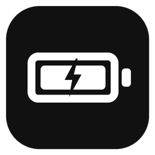
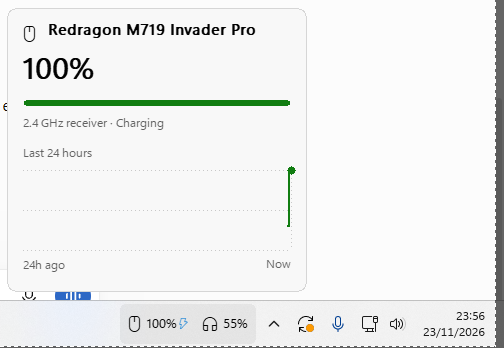

<p align="center"></p>

<h1 align="center">BatteryHub v1.5.1</h1>

<p align="center">
<b>Uma versão em Rust, ultraleve, do BatteryHub para Windows.</b><br>
A bateria do seu mouse, fone, teclado e controle sem fio, direto na barra de tarefas,<br>
usando cerca de <b>0,2 MB de RAM</b>.
</p>

<p align="center">
<a href="../../releases/latest"></a>
<a href="../../actions/workflows/ci.yml"></a>


</p>

<p align="center">

</p>

> [!NOTE]
> **Fork de [marcosniciu](https://github.com/marcosniciu)** do BatteryHub de [@ferloom](https://github.com/ferloom/Wireless-Device-Battery-Monitor) (GPL-3.0). Mantém todos os drivers do original e acrescenta:
>
> - **Redragon M719 Invader Pro** no receptor `25A7:FA7E`: nível e carregando (`src/drivers/redragon.rs`, protocolo observado no software oficial da Redragon e testado no aparelho);
> - **JBL Quantum 910 Wireless** no receptor `0ECB:2088` (`src/drivers/jbl.rs`, testado no aparelho);
> - **HyperX Cloud Stinger Core** no receptor `03F0:0A93`: aceita o código `09` que o fone envia carregando (antes o fone não aparecia).
>
> As atualizações automáticas deste fork vêm só das [versões deste repositório](../../releases).
> **[Baixar o instalador](../../releases/latest)**.

> [!IMPORTANT]
> **O BatteryHub de @ferloom é uma recriação do krisgfx9/Wireless-Device-Battery-Monitor** (o BatteryHub em C++ de krisgfx9), não um fork e não o original.
> Ele reescreve o original em Rust. A ideia, o visual da faixa na barra de tarefas e os protocolos dos aparelhos vêm do projeto original, e o crédito por eles é dos seus autores.
>
> **O original está indisponível no GitHub.** Em 22 de novembro de 2026 a conta krisgfx9 foi suspensa pelo GitHub, o que tirou o repositório original do ar. Segundo o autor original, nenhum motivo foi informado; ele recorreu, então o original pode voltar. Até lá, o autor original distribui os downloads pelo Discord do projeto.

Desenvolvido por [@ferloom](https://github.com/ferloom) com a ajuda do Claude (IA). Drivers do Redragon M719 e do JBL Quantum 910 por [@marcosniciu](https://github.com/marcosniciu), também com a ajuda do Claude.

---

## Conteúdo

[Baixar](#baixar) · [Problema com uma versão nova?](#problema-com-uma-versão-nova-volte-e-avise) · [Recursos](#recursos) · [Como usar](#como-usar) · [Instalador](#instalador-instalar--atualizar--desinstalar) · [Uso de recursos](#uso-de-recursos-comparado-ao-original) · [Compatibilidade com a barra de tarefas](#compatibilidade-com-a-barra-de-tarefas) · [Aparelhos suportados](#aparelhos-suportados) · [Aparelhos não suportados](#aparelhos-não-suportados) · [Testes](#testes) · [Compilar](#compilar-a-partir-do-código) · [Licença](#licença)

## Baixar

Baixe o **`BatteryHub-Taskbar-Setup-v1.5.1.exe`** da [**versão mais recente**](../../releases/latest), abra e escolha **[1] Install**.

- Não precisa de administrador (instala só para o seu usuário).
- Já instalado? Use *Check for updates...* no menu do clique direito, ou abra o instalador novo e escolha **[2] Update**.
- Não interfere no BatteryHub original em C++, se você também tiver ele instalado.
- O Windows pode mostrar um aviso do SmartScreen porque o arquivo não é assinado: *Mais informações* → *Executar assim mesmo*.

## Problema com uma versão nova? Volte e avise

Se algo quebrar depois de uma atualização, dá para voltar a uma versão anterior manualmente:

1. Abra as [**versões**](../../releases) e baixe o instalador de uma versão anterior.
2. Abra. Ele encontra a versão mais nova instalada e oferece **[1] Reinstall**: escolha, e ele troca o programa pela versão dele (mais antiga). Os níveis de aviso e as opções de atualização são mantidos; ele pergunta de novo se o BatteryHub deve iniciar com o Windows.

O *Check for updates* nunca oferece uma versão mais antiga, então a volta continua valendo até você atualizar de novo.

**Avise também o problema** em [**Issues**](../../issues/new) para que seja corrigido na próxima versão. Ajuda incluir:

- a versão com problema e a que funciona (as duas aparecem no topo da janela do instalador);
- a versão do Windows e da barra de tarefas (Windows 11, Windows 10, ExplorerPatcher: barra normal ou pequena);
- seus aparelhos (ex.: "Redragon M719 no receptor", "AirPods por Bluetooth");
- o que aconteceu e o que você esperava, de preferência com um print da barra de tarefas.

## Recursos

- **Na barra de tarefas, ao lado do relógio:** um ícone e a porcentagem de cada aparelho (`🎧 27%  🖱 96%`), no visual do original (Segoe Fluent Icons, Segoe UI Variable, ClearType), seguindo o modo claro / escuro e o DPI.
- **Passe o mouse em um aparelho** para ver um cartão com o nome, o nível, a conexão e um gráfico das **últimas 24 horas**, com animação de entrada e troca suave entre aparelhos, como as miniaturas de janelas da barra; a faixa acende como os botões da própria barra. O histórico guarda um ponto por mudança (no mínimo a cada 10 minutos), é apagado depois de 24 horas e fica junto com as configurações (`History`), então o desinstalador também o remove.
- **Carregamento de relance:** ⚡ verde carregando, ⚡ azul em 100%, porcentagem vermelha no nível de aviso do aparelho ou abaixo dele.
- **Nível de aviso por aparelho:** 50 / 40 / 30 / 20 / 15 / 10 / 5%.
- **Reage na hora** quando um receptor, cabo ou aparelho Bluetooth conecta ou desconecta, e em cerca de 10 s quando um fone num receptor 2.4 GHz é ligado ou desligado.
- **Intervalo de atualização** de 1 / 5 / 10 / 30 minutos ou 1 hora.
- **Vários monitores:** mostra a faixa em todos os monitores, só no principal, ou só em um outro; em cada barra ela fica ao lado do relógio daquela barra e aparece no mesmo momento.
- **Ícones na área de notificação** (opcional): um ícone por aparelho, posicionado pelo próprio Windows, que pode ser arrastado entre os outros ícones e nunca fica por cima de outros widgets da barra.
- **Ao lado de outros widgets da barra:** quando outro programa coloca um widget na barra (medidores de rede ou CPU...), o BatteryHub fica à esquerda dele em vez de por cima.
- **Posição e fundo:** afaste a faixa do relógio e, se quiser, coloque um fundo atrás dela para barras transparentes.
- **Iniciar com o Windows** e **procurar atualizações automaticamente**, ligados ou desligados direto no menu.
- **Procurar atualizações** pelo menu, com download verificado por SHA-256.
- **Pedir suporte para um aparelho** pelo menu: escolha um aparelho que não aparece, e uma issue no GitHub abre preenchida com o que é preciso para adicioná-lo.
- **Minúsculo:** cerca de 0,1–0,2 MB de RAM parado ("Memória" no Gerenciador de Tarefas), cerca de 0,1 s de CPU por minuto.
- **Uma cópia só:** abrir o BatteryHub de novo enquanto ele roda não faz nada.
- **Alternativa segura:** ícones na área de notificação numa barra vertical ou num layout desconhecido do Explorer.

## Como usar

| Na faixa | Significado |
|---|---|
| Porcentagem **vermelha** | No nível de aviso do aparelho ou abaixo (padrão 15%) |
| **⚡ verde** | No cabo, carregando |
| **⚡ azul** | No cabo, carregado em 100% |
| Apagado | Dormindo (receptor ainda conectado), mostrando o último valor conhecido |

O clique esquerdo não faz nada (de propósito: a faixa não atrapalha). O **clique direito** abre o menu (os itens do app estão em inglês):

| Item do menu | O que faz |
|---|---|
| *Nome do aparelho (nível, estado)* ▸ | *Red warning at or below* (aviso vermelho em ou abaixo de) 50 / 40 / 30 / 20 / **15** / 10 / 5% para aquele aparelho |
| *Refresh devices* | Procura os aparelhos de novo; os que sumiram desaparecem |
| *Refresh battery levels* | Lê os níveis de novo |
| *Refresh battery every* ▸ | **1 minuto** / 5 / 10 / 30 minutos / 1 hora |
| *Refresh when a device connects or disconnects* | **Ligado** por padrão; veja abaixo |
| *Show as notification-area icons (Windows arranges them)* | **Desligado** por padrão. Em vez da faixa, um ícone por aparelho na área de notificação com o nível desenhado nele. O Windows posiciona esses ícones como qualquer outro: arraste para reordenar ou para dentro e fora dos ícones ocultos. Ícones novos começam escondidos atrás do ^ (o Windows 11 faz isso com todo app): arraste-os para a barra ou ative-os uma vez em *Configurações → Personalização → Barra de tarefas → Outros ícones da bandeja do sistema*; o Windows lembra por aparelho |
| *Background behind taskbar text (for translucent taskbars)* | **Desligado** por padrão. Uma placa arredondada na cor da barra atrás da faixa, para continuar legível numa barra transparente (TranslucentTB, Windhawk Taskbar Styler...) |
| *Position on the taskbar* ▸ | **Ao lado da área de notificação** ou de 20 a 200 px à esquerda dela (de 20 em 20 px), por exemplo para abrir espaço para outro widget (iCUE, medidores de rede...). Vale também nos outros monitores. Um valor definido à mão (`TaskbarOffset`) aparece como *Custom* |
| *Height on the taskbar* ▸ | 5 / 10 / 15 px para cima, **Centralizado**, ou 5 / 10 / 15 px para baixo. Vale também nos outros monitores. Um valor definido à mão (`TaskbarOffsetY`) aparece como *Custom* |
| *Show widget on* ▸ | Só com mais de um monitor: *All monitors* / **Main monitor only** / *Display 2 (left) only*... O monitor é lembrado pela identidade, não pelo número; enquanto ele está desconectado, a faixa fica na barra principal. Os outros monitores precisam de *Mostrar minha barra de tarefas em todas as telas* no Windows (barras de outros programas, como o DisplayFusion, não são suportadas) |
| *Automatically start with Windows* | Adiciona ou remove a entrada de início automático (`HKCU\Software\Microsoft\Windows\CurrentVersion\Run\BatteryHub Taskbar`) |
| *Automatically check for updates* | **Desligado** por padrão. Ligado, o BatteryHub consulta o GitHub uma vez, cerca de 2 s depois de abrir (não enquanto roda; se a rede ainda não estiver pronta, tenta de novo a cada 15 s, até 8 vezes); se houver versão nova, você recebe a mesma pergunta do *Check for updates...* |
| *Install updates silently* | **Desligado** por padrão; precisa da verificação automática. Quando ela acha uma versão nova, o BatteryHub baixa, confere o SHA-256 e instala em segundo plano: sem pergunta, sem janela do instalador, sem mensagem de "Update finished". Configurações e início automático são mantidos. |
| *Request support for a device...* | Lista todos os aparelhos que o BatteryHub enxerga (HID, USB e Bluetooth; de fornecedor e de áudio primeiro). Escolha o seu, confira nome e tipo, adicione notas, e *Send* abre uma issue nova no GitHub no navegador, preenchida exatamente com o que a janela mostra: nome, tipo, seu nome (opcional, a issue é pública), notas, VID / PID, resumo das interfaces HID e USB, versão do Windows. Você envia por lá (precisa de conta no GitHub); nada é enviado pelo app. *Copy full report* copia o mesmo mais a lista de todos os aparelhos. Também disponível como `batteryhub-taskbar.exe --report` |
| *Check for updates...* | "No new updates" (sem atualizações), ou "A new update is available: v1.5.1 → v1.x - update now?" (atualizar agora?). *Yes* baixa o instalador, confere o SHA-256 da versão e abre; ele atualiza e reinicia o BatteryHub, mantendo configurações e início automático |
| *Exit* | Fecha o BatteryHub |

O cartão e o menu seguem o tema da barra (escuro ou claro); a janela *Request support* segue o tema dos apps do Windows.

**Quando um aparelho chega ou sai** (com *Refresh when a device connects or disconnects* ligado):

| Evento | Aparece depois de |
|---|---|
| Receptor USB / cabo conectado ou removido | ~1–3 s (avisos de dispositivo do Windows; cada leitura também confere se o conjunto de aparelhos HID mudou) |
| Aparelho Bluetooth (AirPods, fones, controles) conecta ou desconecta | alguns segundos (conexões conferidas a cada 3 s); AirPods só enquanto conectados a este PC |
| Fone num receptor 2.4 GHz ligado ou desligado | ~10 s (receptores de fone conferidos a cada 10 s) |
| Mouse / teclado dormindo, receptor ainda conectado | continua, apagado, com o último nível |
| PC acorda | alguns segundos |

## Instalador: instalar / atualizar / desinstalar

O instalador é uma janela de console com registro detalhado. Antes de mostrar as opções, ele **verifica o seu PC**:

- se o BatteryHub está instalado, qual versão e onde;
- o arquivo do programa (tamanho e data), os atalhos, o início automático e se ele está rodando;
- se o BatteryHub original em C++ está instalado (só informa, nunca mexe).

| Opção | Quando | O que faz |
|---|---|---|
| **[1] Install** / **Reinstall** | sempre | Instala, cria atalhos na área de trabalho e no menu Iniciar e pergunta *"Add to Windows autostart? [Y/n]"* (iniciar com o Windows?). Registra cada bloco gravado (com conferência CRC-32) e cada arquivo e entrada de registro criados |
| **[2] Update** | há uma versão mais antiga instalada | Troca o programa e mantém configurações e início automático; reinicia se estava rodando |
| **[3] Uninstall** | instalado | Fecha o programa, confere todos os locais de início automático (HKCU / HKLM Run, RunOnce, estado de inicialização do Gerenciador de Tarefas, pasta Inicializar) e remove as entradas que o abrem, depois os atalhos, arquivos e configurações. Lista tudo o que removeu |
| **[0] Exit** | sempre | Não muda nada |

O BatteryHub também aparece em **Configurações → Aplicativos → Aplicativos instalados**, onde *Desinstalar* faz a mesma desinstalação.

No fim ele agradece, mostra o link do projeto (uma ⭐ ajuda!) e fecha sozinho depois de 5 segundos. Se houver erro, fica aberto.

Linha de comando para scripts: `/install`, `/update`, `/uninstall`, `/S` (silencioso), `/autostart=yes|no`, `/nolaunch`, `/nonotify` (sem a mensagem "Update finished" no fim).

| Onde ficam os arquivos | |
|---|---|
| Programa | `%LOCALAPPDATA%\Programs\BatteryHub\Taskbar\batteryhub-taskbar.exe`, mais `BatteryHub-Setup.exe` (uma cópia do instalador que o *Desinstalar* das Configurações usa) |
| Entrada em Configurações → Aplicativos | `HKCU\Software\Microsoft\Windows\CurrentVersion\Uninstall\BatteryHub Taskbar` |
| Atalhos | Área de trabalho e `Menu Iniciar\Programas\BatteryHub\BatteryHub Taskbar.lnk` |
| Configurações | `HKCU\Software\BatteryHub\Taskbar`: `Thresholds` (por aparelho), `RefreshMinutes`, `RefreshOnDeviceChange`, `TaskbarOffset` (DWORD, distância do relógio em pixels), `TaskbarOffsetY` (DWORD, deslocamento para cima / baixo em pixels, + = baixo), `WidgetMonitor` (`all`, `main` ou o id de um monitor), `WidgetBackground`, `AutoCheckUpdates`, `SilentUpdates`, `NotificationIcons`, `History` (binário, últimas 24 horas de níveis) |
| Início automático | `HKCU\...\Run` → `BatteryHub Taskbar` (se você escolheu) |

O BatteryHub original em C++ usa outros nomes (`Program Files\BatteryHub`, `HKCU\Software\WirelessBattery`, início automático `WirelessBattery`) e nunca é tocado.

## Uso de recursos comparado ao original

Os dois programas rodando **lado a lado no mesmo PC**, com os mesmos aparelhos conectados (mouse Logitech LIGHTSPEED, receptor de fone SteelSeries 2.4 GHz, Bluetooth), configurações padrão (atualização a cada minuto), medidos a cada 2 s durante 3 minutos depois de abrir. Método, medições brutas e rodadas anteriores: [bench/RESULTS.md](bench/RESULTS.md).

| | **BatteryHub (Rust) v1.1** | BatteryHub (C++) 1.1.0 | |
|---|---:|---:|---:|
| **RAM no Gerenciador de Tarefas** (coluna "Memória"), mediana | **0,20 MB** | 4,66 MB | **23× menos** |
| RAM no Gerenciador de Tarefas, média / máximo | 0,33 / 0,82 MB | 4,65 / 4,92 MB | |
| Working set com DLLs compartilhadas do sistema | **1,3 MB** | 27,5 MB | 21× menos |
| Bytes privados (commit) | **4,6 MB** | 6,0 MB | |
| Tempo de CPU por minuto | **0,11 s** | 0,88 s | 8× menos |
| Threads | **9** | 15 | |
| Handles | 367 | 375 | |
| Arquivo do programa | **cerca de 500 KB** | 1.958 KB | 4× menor |

**v1.5**, com cerca de 40 drivers a mais, o cartão e o histórico de 24 horas: programa de 867 KB, instalador de 1,6 MB. Numa verificação de 90 segundos, a mediana no Gerenciador de Tarefas foi **0,12 MB**, com picos curtos de até cerca de 1 MB durante a leitura dos aparelhos.

O que o mantém pequeno: a memória usada só por um instante (uma leitura, uma checagem de Bluetooth) é devolvida ao Windows logo depois; as configurações ficam em cache; o Bluetooth LE só é escutado durante a leitura; a lista de aparelhos fica em cache e só é refeita quando muda; só os nós de Bluetooth são enumerados; as APIs de controle do Xbox e o WinHTTP só são carregados quando necessário.

**Para ser justo:** o original tem mais drivers (cerca de 100), cores das marcas e mais opções. Parte da diferença é menos código fazendo menos coisas, não só a linguagem.

## Compatibilidade com a barra de tarefas

A faixa é uma pequena janela em camadas colocada dentro da barra de tarefas, à esquerda da área de notificação, a mesma técnica do original. Ela depende do layout de janelas do Explorer, então o BatteryHub confere a cada segundo e tem alternativas seguras:

| Situação | O que o BatteryHub faz |
|---|---|
| Windows 11, Windows 10, ExplorerPatcher (inclusive a barra pequena do Windows 10) | Faixa ao lado do relógio; no layout do Windows 10 os botões de tarefas são estreitados para nunca ficarem por baixo dela |
| O Explorer reinicia | Recria exatamente uma faixa na barra nova (janelas de faixa perdidas são removidas a cada segundo) |
| Muda a altura da barra, o DPI ou o tema (ex.: ao sair da tela cheia) | Redesenha a faixa |
| Barra vertical, layout desconhecido do Explorer, ou a faixa não pode ser posicionada por 3 s | **Um ícone por aparelho na área de notificação** (nível desenhado no ícone, uma dica curta e o mesmo menu), voltando à faixa quando possível |

## Aparelhos suportados

| Família | Observações |
|---|---|
| **Redragon** | **M719 Invader Pro** no receptor 2.4 GHz `25A7:FA7E` (feature report 08 em FF02:0002, resposta no input report 09 em FF01; observado no software oficial da Redragon, testado no aparelho; este fork) |
| **JBL** | **Quantum 910 Wireless** no receptor 2.4 GHz `0ECB:2088` (feature reports 68 = ligado, 49 = bateria, como mapeado pelo [jbl-quantum-linux](https://github.com/Tymon3310/jbl-quantum-linux); testado no aparelho; este fork) |
| Logitech | HID++ 1.0 / 2.0 por Unifying, Bolt, LIGHTSPEED, Bluetooth e USB, mais fones G (curvas de tensão) |
| SteelSeries | Arctis 1 / 7 / 9 / Pro, Arctis Nova (3P, 5, 7, 7+, Pro), GameBuds, Aerox, Prime, Rival |
| Razer | Mouses, teclados e receptores (protocolo de feature report de 90 bytes); fone BlackShark V3 pelo receptor HyperSpeed `1532:057A` ou cabo USB `1532:0579` (protocolo do OpenRazer PR #2794 e Joule); BlackShark V2 Pro (2023) pelo receptor HyperSpeed `1532:0555` (protocolo do OpenRazer PR #2862 e [blackshark-battery](https://github.com/matej-basic/blackshark-battery), MIT); Barracuda X Chroma pelo receptor 2.4 GHz `1532:0574` (protocolo do [batterywatch](https://github.com/itayavra/batterywatch), GPL-3.0) |
| Corsair | Fones da família Void, incluindo HS70 Pro Wireless `1B1C:0A4F`, pelo receptor 2.4 GHz (protocolo do [HeadsetControl](https://github.com/Sapd/HeadsetControl) e do driver Linux `hid-corsair-void`) |
| AULA / MCHOSE | Teclados AULA F75 / F87 Pro / F99 (Pro) e MCHOSE no receptor "BY" `3554:FA09` / `3554:FB40` / `41E4:2001` (protocolo do [Device-Battery-Info](https://github.com/PyFlat/Device-Battery-Info), [womier-l65-linux](https://github.com/deepan-alve/womier-l65-linux) e do M HUB da MCHOSE, como reunido no projeto original); mouses MCHOSE (K7, L7, M7, A7) no VID `5253` e nos receptores `3837:1001` (K7 Ultra) / `100A` / `100B` / `100C` / `1012` (protocolo do [mchose-linux](https://github.com/alexfrih/mchose-linux); os ids `3837` do projeto original); fone MCHOSE V9 Pro `291D:385D` (protocolo do [HaloBattery](https://github.com/HeyOkay/HaloBattery), MIT) |
| ATK / VXE | Mouses no receptor NK mouse NANO `373B:1216` (ex.: ATK A9 PLUS 2.0, VXE R1 NK; protocolo do [HaloBattery](https://github.com/HeyOkay/HaloBattery) e [mouse-battery](https://github.com/qwr79/mouse-battery)) |
| Darmoshark | M3 e M3S nos receptores Telink 2.4 GHz `248A:FF30` / `248A:FF31` (protocolo do [darmoshark-m3-configurator](https://github.com/Barba2k2/darmoshark-m3-configurator), MIT; ids do M3S do projeto original) |
| Teclados VGN / VXE / ATK (Evision) | VGN S99, V98 PRO, V98pro V2, N75 PRO, VXE75 (V2), VXE V87, ATK V75X e "Wireless Gaming Keyboard" (ex.: Feker Alice80) no receptor 2.4 GHz `320F:5088` ou cabo USB `320F:5055` (protocolo do [HaloBattery](https://github.com/HeyOkay/HaloBattery), MIT, e do VGN HUB, como reunido no projeto original) |
| Pulsar / Kysona / VXE / LAMZU (CompX) | Pulsar X2 V2 / X2H / X2A / Xlite V3 (`3554:F507` / `F508` / `F509`), Kysona M600 (`F57C` / `F57D` / `F5D5`), VXE R1 SE+ (`373B:1085`, `3554:F58F`), VXE Dragonfly R1 Pro (Max) (receptor `3554:F58A`, cabo `F58C`), geração LAMZU Atlantis / Thorn no LAMZU 4K Receiver (`3554:F510`, cabo `F50F`) (protocolo do driver Linux `hid-pulsar`, [vxe-r1-pro-max-battery](https://github.com/S1berla/vxe-r1-pro-max-battery) e [HaloBattery](https://github.com/HeyOkay/HaloBattery), MIT) |
| Scyrox / ATK 8K (CompX) | Scyrox V6 / V8 no SCYROX 8K Dongle `3554:F5F7` ou cabo USB `3554:F5F6`; mouses ATK (ex.: Fire X 8K) no ATK Mouse 8K Dongle `373B:101B` (CompX report 8; ids e protocolo do [HaloBattery](https://github.com/HeyOkay/HaloBattery) e [MouseDock](https://github.com/late-autumn-gif/mousedock), ambos MIT, e [BrimDeck](https://github.com/MoFeng2223/BrimDeck), Apache-2.0) |
| Mouses AULA | X9 Ultra, V9 / V9 Max+ e outros mouses AULA no AULA-8K Dongle `320F:22A0` (protocolo do [HaloBattery](https://github.com/HeyOkay/HaloBattery), MIT, e do BatteryHub original em C++) |
| MCHOSE (mouses mais novos) | K7 V2 Ultra+, A7 V3 Ultra+ e os outros mouses nos receptores mais novos da MCHOSE `3837:1014` / `1018` / `1016` / `102C` / `102D`, cabo do K7 V2 Ultra+ `3837:4028` (leitura de informações do M HUB, como documentado pelo [MchoseBatteryTray](https://github.com/HifumiDaisuki01/MchoseBatteryTray), MIT, e pelo BatteryHub original em C++) |
| AJAZZ AJ139 V2 MC | No receptor 2.4 GHz `A8A5:2255` ou cabo USB `A8A4:2255` (protocolo do [ajazz-aj139-macos](https://github.com/werquess/ajazz-aj139-macos), MIT) |
| Jabra | Fones atrás de um receptor Jabra Link 390 `0B0E:2E50` / `2E51` / `2E56` / `2E57` (GN Protocol como documentado pelo [HeadsetControl](https://github.com/Sapd/HeadsetControl), GPL-3.0, e pelo BatteryHub original em C++) |
| Receptores Rongyuan | Mouses e teclados nos receptores 2.4 GHz Rongyuan do driver web da Attack Shark (88 ids, ex.: Attack Shark R3 `3151:402D`, EWEADN GS01 `3151:5031`, AJAZZ, Akko Air 01) (protocolo do [BatteryTray](https://github.com/qu1ncky/BatteryTray), MIT) |
| Teclados SONiX | AULA F108 Pro, AJAZZ AK820 MAX e AJAZZ AK35I Pro V3 no receptor `05AC:024F`, AJAZZ AK980 V2 / AK820 Pro em `0C45:FEFE` / `0C45:FDFD`, só no modo 2.4G (protocolo do [sonix-keyboard-studio](https://github.com/donglover69/sonix-keyboard-studio), [ak820-rs](https://github.com/deddroid/ak820-rs) e [ak820-studio](https://github.com/usharik/ak820-studio)) |
| WLMOUSE | Beast X, Beast X Mini, Mini Pro e Max pelos seus receptores (protocolo do [HaloBattery](https://github.com/HeyOkay/HaloBattery), MIT) |
| Mouses DriverCore (VID `373E`) | Mouses no VID compartilhado `373E` com o feature report de status de 65 bytes, ex.: "R6 Mouse 2.4G" `373E:0022`, receptores LAMZU e Arbiter Studio (a consulta de status do WLMOUSE, como documentado pelo BatteryHub original em C++ a partir dos drivers web da LAMZU / Arbiter, GPL-3.0) |
| Flydigi | Apex 6 / Apex 6 Pro `37D7:2502` no receptor 2.4 GHz ou cabo (protocolo do `SDL_hidapi_flydigi.c` do [SDL](https://github.com/libsdl-org/SDL), zlib) |
| HyperX | Fone Cloud III S Wireless pelo receptor 2.4 GHz `03F0:06BE` / `03F0:02CC` (protocolo como documentado pelo [HyperX-Battery-Tray](https://github.com/GuacamoleGH/HyperX-Battery-Tray), [hyperx-battery-logger](https://github.com/OZX-OG/hyperx-battery-logger) e [HyperHeadset](https://github.com/LennardKittner/HyperHeadset), todos MIT) |
| HyperX Cloud II Core Wireless | Pelo receptor 2.4 GHz `03F0:0995` (segundo id `03F0:0795`) (protocolo do [HaloBattery](https://github.com/HeyOkay/HaloBattery) e [HyperHeadset](https://github.com/LennardKittner/HyperHeadset), ambos MIT) |
| HyperX Cloud Flight | Pelo receptor 2.4 GHz `0951:1723` (e `0951:16C4`); nível em passos de 5 %, sem nível enquanto carrega; contribuição de [estebannoemr](https://github.com/estebannoemr) no #93, testado no aparelho (protocolo do [hyperx-cloud-flight](https://github.com/kondinskis/hyperx-cloud-flight) e [hyperx-cloud-flight-wireless](https://github.com/srn/hyperx-cloud-flight-wireless), ambos MIT) |
| HyperX (fones antigos) | Cloud Stinger Core Wireless (`0951:170B`, receptores PlayStation `0951:1713` / `03F0:0A93` / `03F0:0B93`) pelos receptores 2.4 GHz; neste fork também enquanto carrega (código `09`, testado no `03F0:0A93`) (protocolos do [HeadsetControl](https://github.com/Sapd/HeadsetControl), GPL-3.0, [HyperHeadset](https://github.com/LennardKittner/HyperHeadset), MIT, e [HyperBatteryMonitor](https://github.com/davidsantanaalves/HyperBatteryMonitor), MIT, como usado pelo BatteryHub original em C++) |
| Logitech G533 | Fone pelo receptor `046D:0A66`, lido com o pedido fixo de bateria HID++ (protocolo e calibração de tensão do [HeadsetControl](https://github.com/Sapd/HeadsetControl), GPL-3.0) |
| ZOWIE | Mouses da série DW (FK2-DW, U2-DW, S2-DW, EC-DW ...) no receptor DW `04A5:800A`, ZOWIE U2 em `04A5:8008`; nível estimado pela tensão da bateria, carregamento na base deduzido pela tendência (protocolo do [zowie-battery-tray](https://github.com/IgnacioBarb/zowie-battery-tray), MIT, como usado pelo BatteryHub original em C++) |
| Keychron | Mouses (M1, M2, M3, M3 mini, M6, M7) no receptor Keychron Link `3434:D030` / `3434:D031`; teclados nele só com o patch de firmware `KC_GET_BATTERY` ([ldkv/qmk_firmware#1](https://github.com/ldkv/qmk_firmware/pull/1)), já que o firmware de fábrica dos teclados só informa a bateria por Bluetooth (protocolo como documentado pelo BatteryHub original em C++, GPL-3.0) |
| ROCCAT | Fone Syn Max Air pelo receptor 2.4 GHz (curva de tensão; nível aproximado enquanto carrega) |
| FNATIC | Mouse BOLT pelo receptor `2F0E:0203` (o cabo USB `2F0E:0204` só marca como carregando); contribuição de [Jere2201](https://github.com/Jere2201) no #48, a partir de capturas USBPcap, testado no aparelho |
| Attack Shark / Delux / Inphic | Mouses (ex.: X1, X11) no receptor Xenta 2.4 GHz `1D57:FA60` (protocolo do [Attack Shark Battery KDE](https://gitlab.com/gabriel17166/Attack-Shark-Battery-KDE) e [attackshark-battery-windows](https://github.com/daeoxide/attackshark-battery-windows), ambos MIT); Delux M900 Pro e Inphic IN10 (R) MAX no receptor `1D57:FA65` (frames do [omarchy-delux-m900](https://github.com/AeonArcHQ/omarchy-delux-m900), MIT, e do projeto original) |
| Sony | DualShock 4, DualSense, DualSense Edge (USB e Bluetooth) |
| Apple | AirPods e Beats, pelos anúncios de proximidade BLE (esquerdo / direito / estojo) |
| Bluetooth | Qualquer aparelho cuja bateria o Windows conhece, mais a divisão esquerdo / direito / estojo do Google Fast Pair |
| HID genérico | Aparelhos que expõem o uso padrão Battery Strength |
| Xbox | Windows.Gaming.Input (% exata) e XInput (níveis aproximados) |

Seu aparelho não aparece? Use *Request support for a device...* no menu do clique direito (veja acima). Mais marcas do projeto original podem ser adicionadas, uma por arquivo em `src/drivers/`; pull requests são bem-vindos. Aparelhos podem ser ignorados com `HKCU\Software\WirelessBattery\IgnoreDevices` (lista `VID:PID`, a mesma configuração do original).

## Aparelhos não suportados

Aparelhos que foram pedidos ao projeto de @ferloom mas ainda não podem ser suportados, e o motivo (os números de issue são do [repositório de @ferloom](https://github.com/ferloom/Wireless-Device-Battery-Monitor/issues)). A maioria ainda pode mostrar a bateria por **Bluetooth**, se o aparelho tiver: sempre que o Windows mostra o nível em *Configurações → Bluetooth e dispositivos*, o BatteryHub também mostra. `batteryhub-taskbar.exe --listen VID:PID` grava o que um receptor envia sem enviar nada a ele.

| Aparelho | VID:PID | Motivo | Issue |
|---|---|---|---|
| Fone Logitech G435 (LIGHTSPEED) | `046D:0ACB`, `046D:0ADF` | O receptor só informa a bateria em modo bootloader, que corta o áudio; o BatteryHub nunca mexe nele. Por Bluetooth funciona. | #10, #56, #92 |
| Havit Fuxi-H3 e o mesmo receptor em fones Redragon / Rexus / Ardor | `040B:0897` | O receptor só envia teclas de volume / mudo; o comando que o app da Havit usa não é conhecido | #6, #79 |
| Mad Dog GH750K, IO Graphite 2 Pro Wireless (receptor JieLi), "GAMING HEADSET B2" | `4C4A:4155`, `3634:4155` | Sem consulta de bateria documentada; os canais de fornecedor do receptor pertencem ao chip de áudio (firmware / configurações), então comandos não são chutados | #1, #30, #97 |
| Fone Bloody MR710 | `10D6:4801` | O receptor com chip Actions só tem áudio, teclas de mídia e os canais do próprio chip; sem consulta de bateria documentada. Por Bluetooth funciona quando o Windows mostra o nível. | #31 |
| Receptor do 8BitDo Retro Mechanical Keyboard | `2DC8:5201` | Sem comando de bateria documentado; o canal de fornecedor também é o de atualização de firmware, então comandos não são chutados | #5 |
| Controle Mojhon Storm / BIGBIG WON | `E2B7:122C` | Receptor XInput que não informa nível de bateria | #8 |
| Rapoo VT9PRO 4K | `24AE:1211` | Sem protocolo documentado | #11 |
| Edifier HECATE G5 Wireless | `35BB:A008` | Sem protocolo documentado | #15 |
| Mouses genéricos "2.4G Wireless Receiver" | `260D:1026`, `3151:3020` | Sem protocolo documentado | #14, #16 |
| Mouses no receptor AULA "BY" | `3554:FA09` | Só os teclados AULA / MCHOSE respondem nesse receptor (esses são suportados) | #17 |
| Sinowealth "Gaming Keyboard" | `258A:010C` | Sem protocolo documentado | #19 |
| Bloody R36 Ultra | `1956:3001` | O protocolo Bloody documentado não responde nesse mouse | #24 |
| ThinkPad X1 Presenter Mouse, ProtoArc EM11 NL (Bluetooth) | Bluetooth | O Windows não informa nível de bateria deles por Bluetooth; os receptores 2.4 GHz ainda não foram identificados | #49, #50 |
| Dark Project Nexus | `3554:F53E` | Não está entre os ids CompX (Pulsar / Kysona) documentados; comandos não são chutados | #52 |
| Fone Glorious GHS Wireless InfinitePlay | `3794:D005` | Sem protocolo de bateria documentado para o receptor | #54 |
| Keychron Q6 HE (e outros teclados Keychron QMK no cabo) | `3434:0B60` | O firmware de fábrica da Keychron só informa a bateria por Bluetooth (lá funciona) | #59 |
| Corsair Sabre v3 Pro Wireless (receptor Slipstream V2) | `1B1C:2B42` | A única leitura de bateria documentada ([OpenLinkHub](https://github.com/jurkovic-nikola/OpenLinkHub)) primeiro faz login e coloca o receptor em modo software, o que assume as configurações internas do mouse; o BatteryHub só lê | #98 |
| Teclados Keychron no receptor Keychron Link (firmware de fábrica), ex.: Q1 HE | `3434:D030` | O firmware de fábrica só informa a bateria do teclado por Bluetooth, nunca pelo receptor. Por Bluetooth funciona. | #61 |
| DAREU EK75 Pro | `260D:0042` | Sem protocolo documentado. Por Bluetooth funciona quando o Windows mostra o nível. | #63 |
| Fone L90 (receptor C-Media) | `0D8C:0371` | O receptor só tem áudio e teclas de mídia, sem canal de fornecedor | #64 |
| Fone ONIKUMA GT808 | `3206:0861` | O receptor só tem áudio e teclas de mídia, sem canal de fornecedor. Por Bluetooth funciona quando o Windows mostra o nível. | #65 |
| Mouse "2.4G Wireless Device" | `25A7:FA17` | Sem protocolo documentado (não é o layout CompX / Areson usado em outros receptores `25A7`) | #66 |
| Fone Akko Verge S9 Ultra | `36EB:1087` | Sem protocolo de bateria documentado para o receptor; comandos não são chutados. Por Bluetooth funciona quando o Windows mostra o nível. | #75 |
| Fone EKSA E1000 WT | `3206:109D` | Sem protocolo de bateria documentado para o receptor; comandos não são chutados | #76 |
| HATOR Pulsar 3 Wireless | `379A:3907` | Sem protocolo documentado para o receptor de mouse `379A` da HATOR; comandos não são chutados. Por Bluetooth funciona quando o Windows mostra o nível. | #73 |
| beyerdynamic MMX 200 Wireless | `2E50:002F` | Sem protocolo de bateria documentado para o receptor; os canais de fornecedor não são chutados. Por Bluetooth funciona quando o Windows mostra o nível. | #40 |
| Zoom75 Wireless (Meletrix) | `6D66:8888` | O canal VIA raw HID não tem comando de bateria documentado. Por Bluetooth funciona quando o Windows mostra o nível. | #42 |
| Teclado T87 | `056D:C077` | Sem protocolo documentado | #44 |
| Receptor Keychron TurboLink 8K | `3434:D05A` | Não está entre os ids de receptor Keychron documentados; não está confirmado qual protocolo do Launcher ele usa, então comandos não são chutados | #45 |
| Redragon K1NG 4K PRO (M916 PRO 4K) | `3554:F54F` | Não está entre os ids CompX (Pulsar / Kysona) documentados; comandos não são chutados. Por Bluetooth funciona quando o Windows mostra o nível. | #46 |
| Mouse PIAO-2.4G | `372E:1014` | Sem protocolo documentado para esse receptor `372E` | #47 |
| AJAZZ NJ07 (Bluetooth LE) | — | O Windows não lê nível de bateria dele por Bluetooth; o receptor 2.4 GHz ainda não foi informado | #69 |
| Fone VXE V1 (VGN Siren V1) | `10D6:0016` | Os canais de fornecedor do receptor com chip Actions não são documentados; nenhuma consulta de bateria é conhecida. Por Bluetooth funciona quando o Windows mostra o nível. | #85 |

## Testes

- **Testes unitários** (`cargo test --lib`) decodificam respostas gravadas dos aparelhos sem precisar do hardware: blocos de status do SteelSeries Arctis Nova, relatórios do DualSense / DualShock 4, anúncios de proximidade dos AirPods, campos de bateria do Google Fast Pair, curvas de tensão e agrupamento de receptores da Logitech, e os decodificadores de todos os drivers de fornecedor (frames tirados das fontes dos protocolos; os do Redragon M719, JBL Quantum 910 e HyperX Stinger Core `09` foram gravados nos aparelhos reais). Também cobrem o histórico de 24 horas, o desfoque do cartão, quando um aparelho é removido ou mostrado como dormindo, níveis de aviso, cores, ids do menu, o leitor de versões do GitHub, SHA-256 e comparação de versões.
- O **instalador** tem seus próprios testes (a detecção do início automático nunca mexe no app original, tratamento de versões).
- A **CI** ([GitHub Actions](.github/workflows/ci.yml)) roda todos os testes e compila o programa e o instalador a cada push.
- O **uso de recursos** é medido com [bench/compare.ps1](bench/compare.ps1) (dois programas lado a lado) e [bench/measure.ps1](bench/measure.ps1).

## Compilar a partir do código

Requisitos: Rust 1.99 ou mais novo (stable, toolchain MSVC; os crates usam a edição 2024) e o Visual Studio Build Tools com o Windows SDK (o `rc.exe` embute o ícone).

```powershell
.\build-release.ps1
```

Isso compila o programa, depois o instalador com o programa embutido (`installer/`, `BH_PAYLOAD_DIR`), e grava `release\BatteryHub-Taskbar-Setup-v1.5.1.exe` e `SHA256SUMS.txt`. A versão vem do arquivo `VERSION` (até quatro partes, ex.: `1.0.1.1`).

| Caminho | Conteúdo |
|---|---|
| `src/` | Biblioteca: camada HID, drivers dos aparelhos, escuta BLE, configurações, verificação de atualização, interface e auxiliares do instalador |
| `src/bin/taskbar.rs` | O programa da barra de tarefas |
| `installer/` | O instalador (`src/setup.rs`) |
| `res/` | Ícone (`make_icon.py` desenha), manifesto, script de recursos, prints do README |
| `bench/` | Scripts e resultados de medição de recursos |
| `.github/workflows/ci.yml` | CI: testes e compilação a cada push |
| `examples/list.rs` | Diagnóstico no console: `cargo run --example list -- --dump --ble`, `-- --update` |

## Licença

GPL-3.0 ou posterior, a mesma do projeto original. Veja [LICENSE](LICENSE).
