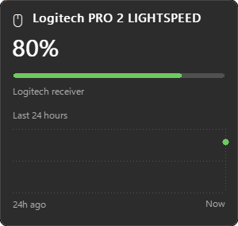
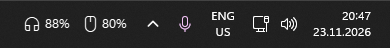

<p align="center"></p>

<h1 align="center">BatteryHub v1.5</h1>

<p align="center">
<b>An ultra-lightweight Rust implementation of BatteryHub for Windows.</b><br>
Battery levels of your wireless mouse, headset, keyboard and controller, right on the taskbar,<br>
in about <b>0.2 MB of RAM</b>.
</p>

<p align="center">
<a href="../../releases/latest"></a>
<a href="../../actions/workflows/ci.yml"></a>


</p>

<p align="center">
<br>

</p>

> [!IMPORTANT]
> **This is a recode of krisgfx9/Wireless-Device-Battery-Monitor** (the C++ BatteryHub by krisgfx9), not a fork and not the original.
> It rewrites the original in Rust. The idea, the look of the taskbar strip and the device protocols all come from the original project, and the credit for them goes to its authors.
>
> **The original is currently unavailable on GitHub.** On 22 November 2026 the krisgfx9 account was suspended by GitHub, which took the original repository offline with it. According to the original author, no reason was given; they have appealed, so the original may come back. Until then, the original author shares downloads through the project's Discord.
>
> This recode is still **not the original**, but it **is supported and will stay supported**: it keeps being developed and updated, with new devices added from [device requests](../../issues).

Developed by [@ferloom](https://github.com/ferloom) with the help of Claude (AI).

---

## Contents

[Download](#download) · [Problem with a new version?](#problem-with-a-new-version-downgrade-and-report-it) · [Features](#features) · [Using it](#using-it) · [Setup](#setup-install--update--uninstall) · [Resource usage vs. the original](#resource-usage-vs-the-original) · [Taskbar compatibility](#taskbar-compatibility) · [Supported devices](#supported-devices) · [Unsupported devices](#unsupported-devices) · [Testing](#testing) · [Building](#building-from-source) · [License](#license)

## Download

Get **`BatteryHub-Taskbar-Setup-v1.5.exe`** from the [**latest release**](../../releases/latest), run it and choose **[1] Install**.

- No administrator rights needed (per-user install).
- Already installed? Use *Check for updates...* in the right-click menu, or run the new setup and choose **[2] Update**.
- It does not interfere with the original C++ BatteryHub if you have that installed too.
- Windows may show a SmartScreen warning because the file is not code-signed: *More info* → *Run anyway*.

## Problem with a new version? Downgrade and report it

If something breaks after an update, you can always go back to an older version by hand:

1. Open [**Releases**](../../releases) and download the setup of an earlier version (e.g. `BatteryHub-Taskbar-Setup-v1.0.1.1.exe`).
2. Run it. It finds the newer version you have installed and offers **[1] Reinstall**: choose it, and it replaces the program with its own (older) version. Your warning levels and refresh options are kept; it asks again whether BatteryHub should start with Windows.

*Check for updates* never offers an older version, so the downgrade stays in place until you update again. Versions before v1.1 do not have *Check for updates*; to come back later, run the newer setup and choose **[2] Update**.

**Please also report the problem** in [**Issues**](../../issues/new) so it can be fixed in the next version. It helps to include:

- the version that has the problem and the one that works (both are shown at the top of the setup window);
- Windows version and taskbar (Windows 11, Windows 10, ExplorerPatcher: normal or small taskbar);
- your devices (e.g. "Logitech PRO 2 LIGHTSPEED on its receiver", "AirPods over Bluetooth");
- what happened and what you expected, ideally with a screenshot of the taskbar.

## Features

- **On the taskbar, next to the clock:** one icon and percentage per device (`🎧 27%  🖱 96%`), in the original's look (Segoe Fluent Icons, Segoe UI Variable, ClearType), following light / dark mode and DPI.
- **Hover a device** for a card with its name, level, connection and a chart of the **last 24 hours**, fading in and cross-fading between devices like the taskbar's window previews; the widget lights up like the taskbar's own buttons. The history keeps one point per change (at least every 10 minutes), is deleted after 24 hours, and is stored with the settings (`History`), so the uninstaller removes it.
- **Charging at a glance:** green ⚡ while charging, blue ⚡ at 100%, red percentage at or below the device's warning level.
- **Per-device warning level:** 50 / 40 / 30 / 20 / 15 / 10 / 5%.
- **Reacts at once** when a receiver, cable or Bluetooth device connects or disconnects, and within ~10 s when a headset on a 2.4 GHz dongle is switched on or off.
- **Refresh interval** of 1 / 5 / 10 / 30 minutes or 1 hour.
- **More monitors:** show the widget on all monitors, the main one only, or only one other monitor; on every taskbar it sits right next to that taskbar's clock and appears at the same moment.
- **Notification-area icons instead** (optional): one icon per device that Windows itself places, so it can be dragged between other tray icons and never overlaps other taskbar widgets.
- **Next to other taskbar widgets:** when another program places its own widget in the taskbar (network or CPU meters...), BatteryHub sits left of it instead of on top of it.
- **Position and background:** move the widget further from the clock, and an optional plate behind it for transparent taskbars.
- **Start with Windows** and **automatic update check** switched on or off right from the menu.
- **Check for updates** from the menu, with a SHA-256-verified download.
- **Request support for a device** from the menu: pick a device that is not shown, and a GitHub issue opens filled in with what is needed to add it.
- **Tiny:** about 0.1–0.2 MB of RAM when idle (Task Manager "Memory"), about 0.1 s of CPU per minute.
- **One copy only:** starting BatteryHub again while it runs does nothing.
- **Safe fallback** to notification-area icons on a vertical taskbar or an unknown Explorer layout.

## Using it

| On the strip | Meaning |
|---|---|
| **Red** percentage | At or below the device's warning level (default 15%) |
| **Green ⚡** | Plugged in and charging |
| **Blue ⚡** | Plugged in and charged to 100% |
| Dimmed | Asleep (receiver still plugged in), showing the last known value |

Left click does nothing (on purpose: the strip stays out of the way). **Right click** opens the menu:

| Menu item | What it does |
|---|---|
| *Device name (level, state)* ▸ | *Red warning at or below* 50 / 40 / 30 / 20 / **15** / 10 / 5% for that device |
| *Refresh devices* | Full rescan; devices that are gone disappear |
| *Refresh battery levels* | Reads the levels again |
| *Refresh battery every* ▸ | **1 minute** / 5 / 10 / 30 minutes / 1 hour |
| *Refresh when a device connects or disconnects* | **On** by default; see below |
| *Show as notification-area icons (Windows arranges them)* | **Off** by default. Instead of the strip, one notification-area icon per device with its level drawn in it. Windows places these icons like any other: drag them to reorder or in and out of the hidden icons. New icons start hidden behind ^ (Windows 11 does that for every app): drag them onto the taskbar or turn them on in *Settings → Personalization → Taskbar → Other system tray icons* once; Windows remembers it per device |
| *Background behind taskbar text (for translucent taskbars)* | **Off** by default. A rounded plate in the taskbar's colour behind the widget, so it stays readable on a transparent taskbar (TranslucentTB, Windhawk Taskbar Styler...) |
| *Position on the taskbar* ▸ | **Next to the notification area** or 20 to 200 px to the left of it (in 20 px steps), e.g. to make room for another taskbar widget (iCUE, network meters...). Also applies on other monitors. A value set by hand (`TaskbarOffset`) shows as *Custom* |
| *Height on the taskbar* ▸ | 5 / 10 / 15 px up, **Centred**, or 5 / 10 / 15 px down. Also applies on other monitors. A value set by hand (`TaskbarOffsetY`) shows as *Custom* |
| *Show widget on* ▸ | Only with more than one monitor: *All monitors* / **Main monitor only** / *Display 2 (left) only*... The monitor is remembered by its identity, not its number; while it is unplugged the widget is on the main taskbar. Other monitors need *Show my taskbar on all displays* in Windows (taskbars of other programs, e.g. DisplayFusion, are not supported) |
| *Automatically start with Windows* | Adds or removes BatteryHub's autostart entry (`HKCU\Software\Microsoft\Windows\CurrentVersion\Run\BatteryHub Taskbar`) |
| *Automatically check for updates* | **Off** by default. When on, BatteryHub checks GitHub once, about 2 s after it starts (not while it runs; if the network is not up yet it tries again every 15 s, up to 8 times); if there is a new version you get the same question as with *Check for updates...* |
| *Install updates silently* | **Off** by default; needs the automatic check. When the check finds a new version, BatteryHub downloads it, verifies its SHA-256 checksum and installs it in the background: no question, no setup window, no "Update finished" message. Settings and autostart are kept. |
| *Request support for a device...* | Lists every device BatteryHub can see (HID, USB and Bluetooth; vendor-specific and audio devices first). Pick yours, check the name and type, add notes, and *Send* opens a new GitHub issue in your browser, filled in with exactly what the window shows: name, type, your name (optional, the issue is public), notes, vendor / product id, HID and USB interface summary, Windows build. You submit it there (a GitHub account is needed); nothing is sent from the app. *Copy full report* copies the same plus the list of all devices. Also available as `batteryhub-taskbar.exe --report` |
| *Check for updates...* | "No new updates", or "A new update is available: v1.1 → v1.x - update now?". *Yes* downloads the setup, checks it against the release's SHA-256 checksum and starts it; it updates and restarts BatteryHub, keeping your settings and autostart |
| *Exit* | Closes BatteryHub |

The hover card and the menu follow the taskbar theme (dark or light); the *Request support* window follows the Windows app theme.

**When a device comes or goes** (with *Refresh when a device connects or disconnects* on):

| Event | Shown after |
|---|---|
| USB receiver / cable plugged in or removed | ~1–3 s (Windows device notifications; every read also checks whether the set of HID devices changed) |
| Bluetooth device (AirPods, headphones, controllers) connects or disconnects | a few seconds (connections are checked every 3 s); AirPods only while connected to this PC |
| Headset on a 2.4 GHz dongle switched on or off | ~10 s (headset dongles are checked every 10 s) |
| Mouse / keyboard asleep, receiver still plugged in | stays, dimmed, with its last level |
| PC wakes up | a few seconds |

## Setup: Install / Update / Uninstall

The setup is a console window with a detailed log. Before it shows any options, it **scans your PC**:

- whether BatteryHub is installed, which version, and where;
- the program file (size and date), the shortcuts, autostart, and whether it is running;
- whether the original C++ BatteryHub is installed (reported, never touched).

| Option | When | What it does |
|---|---|---|
| **[1] Install** / **Reinstall** | always | Installs, creates desktop and Start menu shortcuts and asks *"Add to Windows autostart? [Y/n]"*. Logs every block written (with CRC-32 check) and every file and registry entry it creates |
| **[2] Update** | an older version is installed | Replaces the program and keeps your settings and autostart; restarts it if it was running |
| **[3] Uninstall** | installed | Stops the program, checks every autostart location (HKCU / HKLM Run, RunOnce, Task Manager startup state, Startup folder) for entries that start it and removes them, then the shortcuts, files and settings. Lists everything it removed |
| **[0] Exit** | always | Changes nothing |

BatteryHub also appears in **Settings → Apps → Installed apps**, where *Uninstall* runs the same uninstall.

At the end it thanks you, links to the project (a ⭐ helps!) and closes itself after 5 seconds. On an error it stays open.

Command line for scripts: `/install`, `/update`, `/uninstall`, `/S` (silent), `/autostart=yes|no`, `/nolaunch`, `/nonotify` (no "Update finished" message afterwards).

| Where the files go | |
|---|---|
| Program | `%LOCALAPPDATA%\Programs\BatteryHub\Taskbar\batteryhub-taskbar.exe`, plus `BatteryHub-Setup.exe` (a copy of the setup that *Uninstall* in Settings runs) |
| Settings → Apps entry | `HKCU\Software\Microsoft\Windows\CurrentVersion\Uninstall\BatteryHub Taskbar` |
| Shortcuts | Desktop and `Start Menu\Programs\BatteryHub\BatteryHub Taskbar.lnk` |
| Settings | `HKCU\Software\BatteryHub\Taskbar`: `Thresholds` (per device), `RefreshMinutes`, `RefreshOnDeviceChange`, `TaskbarOffset` (DWORD, gap from the clock in pixels), `TaskbarOffsetY` (DWORD, up / down shift in pixels, + = down), `WidgetMonitor` (`all`, `main` or a monitor id), `WidgetBackground`, `AutoCheckUpdates`, `SilentUpdates`, `NotificationIcons`, `History` (binary, last 24 hours of levels) |
| Autostart | `HKCU\...\Run` → `BatteryHub Taskbar` (if you chose it) |

The original C++ BatteryHub uses different names (`Program Files\BatteryHub`, `HKCU\Software\WirelessBattery`, autostart `WirelessBattery`) and is never touched.

## Resource usage vs. the original

Both programs running **side by side on the same PC**, the same devices connected (Logitech LIGHTSPEED mouse, SteelSeries 2.4 GHz headset dongle, Bluetooth), default settings (refresh every minute), sampled every 2 s for 3 minutes after start-up. Method, raw samples and older runs: [bench/RESULTS.md](bench/RESULTS.md).

| | **BatteryHub (Rust) v1.1** | BatteryHub (C++) 1.1.0 | |
|---|---:|---:|---:|
| **RAM in Task Manager** ("Memory" column), median | **0.20 MB** | 4.66 MB | **23× less** |
| RAM in Task Manager, average / max | 0.33 / 0.82 MB | 4.65 / 4.92 MB | |
| Working set incl. shared system DLLs | **1.3 MB** | 27.5 MB | 21× less |
| Private bytes (commit) | **4.6 MB** | 6.0 MB | |
| CPU time per minute | **0.11 s** | 0.88 s | 8× less |
| Threads | **9** | 15 | |
| Handles | 367 | 375 | |
| Program file | **about 500 KB** | 1,958 KB | 4× smaller |

**v1.5**, with about 40 more device drivers, the hover card and its 24-hour history: program 867 KB, setup 1.6 MB. In a 90-second check the Task Manager median was **0.12 MB**, with short peaks up to about 1 MB while the devices are being read.

What keeps it small: memory needed only for a moment (a read, a Bluetooth check) is handed back to Windows right after; settings are cached; Bluetooth LE is listened to only while reading; the device list is cached and rescanned only when it changes; only Bluetooth device nodes are enumerated; the Xbox input APIs and WinHTTP are loaded only when needed.

**To be fair:** the original has more device drivers (about 100), brand colours and more options. Part of the difference is less code doing less work, not only the language.

## Taskbar compatibility

The strip is a small layered window placed inside the taskbar, left of the notification area, the same technique the original uses. It depends on Explorer's window layout, so BatteryHub checks it every second and falls back safely:

| Situation | What BatteryHub does |
|---|---|
| Windows 11, Windows 10, ExplorerPatcher (also the small Windows 10 taskbar) | Strip next to the clock; on the Windows 10 layout the task buttons are narrowed so they never slide under it |
| Explorer restarts | Recreates exactly one strip on the new taskbar (stray strip windows are removed every second) |
| Taskbar height, DPI or theme changes (e.g. after leaving full screen) | Re-renders the strip |
| Vertical taskbar, unknown Explorer layout, or the strip cannot be placed for 3 s | **One notification-area icon per device** (level drawn in the icon, a short tooltip and the same menu), back to the strip when possible |

## Supported devices

| Family | Notes |
|---|---|
| Logitech | HID++ 1.0 / 2.0 over Unifying, Bolt, LIGHTSPEED, Bluetooth and USB, plus G headsets (voltage curves) |
| SteelSeries | Arctis 1 / 7 / 9 / Pro, Arctis Nova (3P, 5, 7, 7+, Pro), GameBuds, Aerox, Prime, Rival |
| Razer | Mice, keyboards and receivers (90-byte feature report protocol); BlackShark V3 headset over its HyperSpeed dongle `1532:057A` or USB cable `1532:0579` (protocol from OpenRazer PR #2794 and Joule); BlackShark V2 Pro (2023) over its HyperSpeed dongle `1532:0555` (protocol from OpenRazer PR #2862 and [blackshark-battery](https://github.com/matej-basic/blackshark-battery), MIT); Barracuda X Chroma over its 2.4 GHz dongle `1532:0574` (protocol from [batterywatch](https://github.com/itayavra/batterywatch), GPL-3.0) |
| Corsair | Void family headsets incl. HS70 Pro Wireless `1B1C:0A4F` over the 2.4 GHz receiver (protocol from [HeadsetControl](https://github.com/Sapd/HeadsetControl) and the Linux `hid-corsair-void` driver) |
| AULA / MCHOSE | AULA F75 / F87 Pro / F99 (Pro) and MCHOSE keyboards on the "BY" receiver `3554:FA09` / `3554:FB40` / `41E4:2001` (protocol from [Device-Battery-Info](https://github.com/PyFlat/Device-Battery-Info), [womier-l65-linux](https://github.com/deepan-alve/womier-l65-linux) and MCHOSE's M HUB, as collected in the original project); MCHOSE mice (K7, L7, M7, A7) on VID `5253` and on the receivers `3837:1001` (K7 Ultra) / `100A` / `100B` / `100C` / `1012` (protocol from [mchose-linux](https://github.com/alexfrih/mchose-linux); the `3837` ids from the original project); MCHOSE V9 Pro headset `291D:385D` (protocol from [HaloBattery](https://github.com/HeyOkay/HaloBattery), MIT) |
| ATK / VXE | Mice on the NK mouse NANO dongle `373B:1216` (e.g. ATK A9 PLUS 2.0, VXE R1 NK; protocol from [HaloBattery](https://github.com/HeyOkay/HaloBattery) and [mouse-battery](https://github.com/qwr79/mouse-battery)) |
| Darmoshark | M3 and M3S on their Telink 2.4 GHz receivers `248A:FF30` / `248A:FF31` (protocol from [darmoshark-m3-configurator](https://github.com/Barba2k2/darmoshark-m3-configurator), MIT; M3S ids from the original project) |
| VGN / VXE / ATK keyboards (Evision) | VGN S99, V98 PRO, V98pro V2, N75 PRO, VXE75 (V2), VXE V87, ATK V75X and "Wireless Gaming Keyboard" (e.g. Feker Alice80) on the 2.4 GHz receiver `320F:5088` or USB cable `320F:5055` (protocol from [HaloBattery](https://github.com/HeyOkay/HaloBattery), MIT, and VGN HUB, as collected in the original project) |
| Pulsar / Kysona / VXE / LAMZU (CompX) | Pulsar X2 V2 / X2H / X2A / Xlite V3 (`3554:F507` / `F508` / `F509`), Kysona M600 (`F57C` / `F57D` / `F5D5`), VXE R1 SE+ (`373B:1085`, `3554:F58F`), VXE Dragonfly R1 Pro (Max) (`3554:F58A` receiver, `F58C` cable), LAMZU Atlantis / Thorn generation on the LAMZU 4K Receiver (`3554:F510`, cable `F50F`) (protocol from the Linux `hid-pulsar` driver, [vxe-r1-pro-max-battery](https://github.com/S1berla/vxe-r1-pro-max-battery) and [HaloBattery](https://github.com/HeyOkay/HaloBattery), MIT) |
| Scyrox / ATK 8K (CompX) | Scyrox V6 / V8 on the SCYROX 8K Dongle `3554:F5F7` or USB cable `3554:F5F6`; ATK mice (e.g. Fire X 8K) on the ATK Mouse 8K Dongle `373B:101B` (CompX report 8; ids and protocol from [HaloBattery](https://github.com/HeyOkay/HaloBattery) and [MouseDock](https://github.com/late-autumn-gif/mousedock), both MIT, and [BrimDeck](https://github.com/MoFeng2223/BrimDeck), Apache-2.0) |
| AULA mice | X9 Ultra, V9 / V9 Max+ and other AULA mice on the AULA-8K Dongle `320F:22A0` (protocol from [HaloBattery](https://github.com/HeyOkay/HaloBattery), MIT, and the original C++ BatteryHub) |
| MCHOSE (newer mice) | K7 V2 Ultra+, A7 V3 Ultra+ and the other mice on MCHOSE's newer receivers `3837:1014` / `1018` / `1016` / `102C` / `102D`, K7 V2 Ultra+ cable `3837:4028` (M HUB's device-info read, as documented by [MchoseBatteryTray](https://github.com/HifumiDaisuki01/MchoseBatteryTray), MIT, and the original C++ BatteryHub) |
| AJAZZ AJ139 V2 MC | On its 2.4 GHz receiver `A8A5:2255` or USB cable `A8A4:2255` (protocol from [ajazz-aj139-macos](https://github.com/werquess/ajazz-aj139-macos), MIT) |
| Jabra | Headsets behind a Jabra Link 390 dongle `0B0E:2E50` / `2E51` / `2E56` / `2E57` (GN Protocol as documented by [HeadsetControl](https://github.com/Sapd/HeadsetControl), GPL-3.0, and the original C++ BatteryHub) |
| Rongyuan receivers | Mice and keyboards on the Rongyuan 2.4 GHz receivers of Attack Shark's web driver (88 ids, e.g. Attack Shark R3 `3151:402D`, EWEADN GS01 `3151:5031`, AJAZZ, Akko Air 01) (protocol from [BatteryTray](https://github.com/qu1ncky/BatteryTray), MIT) |
| SONiX keyboards | AULA F108 Pro, AJAZZ AK820 MAX and AJAZZ AK35I Pro V3 on the `05AC:024F` dongle, AJAZZ AK980 V2 / AK820 Pro on `0C45:FEFE` / `0C45:FDFD`, 2.4G mode only (protocol from [sonix-keyboard-studio](https://github.com/donglover69/sonix-keyboard-studio), [ak820-rs](https://github.com/deddroid/ak820-rs) and [ak820-studio](https://github.com/usharik/ak820-studio)) |
| WLMOUSE | Beast X, Beast X Mini, Mini Pro and Max over their receivers (protocol from [HaloBattery](https://github.com/HeyOkay/HaloBattery), MIT) |
| DriverCore mice (VID `373E`) | Mice on the shared `373E` vendor id with its 65-byte status feature report, e.g. "R6 Mouse 2.4G" `373E:0022`, LAMZU and Arbiter Studio receivers (the WLMOUSE status query, as documented by the original C++ BatteryHub from the LAMZU / Arbiter web drivers, GPL-3.0) |
| Flydigi | Apex 6 / Apex 6 Pro `37D7:2502` on the 2.4 GHz dongle or cable (protocol from [SDL](https://github.com/libsdl-org/SDL)'s `SDL_hidapi_flydigi.c`, zlib) |
| HyperX | Cloud III S Wireless headset over its 2.4 GHz dongle `03F0:06BE` / `03F0:02CC` (protocol as documented by [HyperX-Battery-Tray](https://github.com/GuacamoleGH/HyperX-Battery-Tray), [hyperx-battery-logger](https://github.com/OZX-OG/hyperx-battery-logger) and [HyperHeadset](https://github.com/LennardKittner/HyperHeadset), all MIT) |
| HyperX Cloud II Core Wireless | Over its 2.4 GHz dongle `03F0:0995` (second id `03F0:0795`) (protocol from [HaloBattery](https://github.com/HeyOkay/HaloBattery) and [HyperHeadset](https://github.com/LennardKittner/HyperHeadset), both MIT) |
| HyperX Cloud Flight | Over its 2.4 GHz dongle `0951:1723` (and `0951:16C4`); level in 5 % steps, no level while charging; contributed by [estebannoemr](https://github.com/estebannoemr) in #93, tested on hardware (protocol from [hyperx-cloud-flight](https://github.com/kondinskis/hyperx-cloud-flight) and [hyperx-cloud-flight-wireless](https://github.com/srn/hyperx-cloud-flight-wireless), both MIT) |
| HyperX (older headsets) | Cloud Stinger Core Wireless (`0951:170B`, PlayStation receivers `0951:1713` / `03F0:0A93` / `03F0:0B93`) over their 2.4 GHz dongles (protocols from [HeadsetControl](https://github.com/Sapd/HeadsetControl), GPL-3.0, [HyperHeadset](https://github.com/LennardKittner/HyperHeadset), MIT, and [HyperBatteryMonitor](https://github.com/davidsantanaalves/HyperBatteryMonitor), MIT, as used by the original C++ BatteryHub) |
| Logitech G533 | Headset over its dongle `046D:0A66`, read with its fixed HID++ battery request (protocol and voltage calibration from [HeadsetControl](https://github.com/Sapd/HeadsetControl), GPL-3.0) |
| ZOWIE | DW-series mice (FK2-DW, U2-DW, S2-DW, EC-DW ...) on the DW receiver `04A5:800A`, ZOWIE U2 on `04A5:8008`; level estimated from the battery voltage, charging on the dock inferred from its trend (protocol from [zowie-battery-tray](https://github.com/IgnacioBarb/zowie-battery-tray), MIT, as used by the original C++ BatteryHub) |
| Keychron | Mice (M1, M2, M3, M3 mini, M6, M7) on the Keychron Link receiver `3434:D030` / `3434:D031`; keyboards on it only with the `KC_GET_BATTERY` firmware patch ([ldkv/qmk_firmware#1](https://github.com/ldkv/qmk_firmware/pull/1)), as stock keyboard firmware reports its battery over Bluetooth only (protocol as documented by the original C++ BatteryHub, GPL-3.0) |
| ROCCAT | Syn Max Air headset over its 2.4 GHz receiver (voltage curve; coarse level while charging) |
| FNATIC | BOLT mouse over its receiver `2F0E:0203` (the USB cable `2F0E:0204` only marks it as charging); contributed by [Jere2201](https://github.com/Jere2201) in #48, from USBPcap captures, tested on hardware |
| Attack Shark / Delux / Inphic | Mice (e.g. X1, X11) on the Xenta 2.4 GHz receiver `1D57:FA60` (protocol from [Attack Shark Battery KDE](https://gitlab.com/gabriel17166/Attack-Shark-Battery-KDE) and [attackshark-battery-windows](https://github.com/daeoxide/attackshark-battery-windows), both MIT); Delux M900 Pro and Inphic IN10 (R) MAX on the `1D57:FA65` receiver (frames from [omarchy-delux-m900](https://github.com/AeonArcHQ/omarchy-delux-m900), MIT, and the original project) |
| Sony | DualShock 4, DualSense, DualSense Edge (USB and Bluetooth) |
| Apple | AirPods and Beats, from BLE proximity broadcasts (L / R / case) |
| Bluetooth | Any device Windows knows a battery level for, plus the Google Fast Pair L / R / case split |
| Generic HID | Devices exposing the standard Battery Strength usage |
| Xbox | Windows.Gaming.Input (exact %) and XInput (coarse levels) |

Device not shown? Use *Request support for a device...* in the right-click menu (see above). More brands from the original project can be added as one file each in `src/drivers/`; pull requests are welcome (the ROCCAT, FNATIC BOLT and HyperX Cloud Flight drivers came from them). Devices can be excluded with `HKCU\Software\WirelessBattery\IgnoreDevices` (`VID:PID` list, the same setting as the original).

## Unsupported devices

Devices that were requested but cannot be supported for now, and why. Most of them can still show their battery over **Bluetooth**, if the device has it: whenever Windows shows the level in *Settings → Bluetooth & devices*, BatteryHub shows it too. If you know how one of these reports its battery (a capture, a project that reads it), please comment on its issue; `batteryhub-taskbar.exe --listen VID:PID` records what a receiver sends without sending anything to it.

| Device | VID:PID | Why | Issue |
|---|---|---|---|
| Logitech G435 headset (LIGHTSPEED) | `046D:0ACB`, `046D:0ADF` | Its dongle gives the battery only in bootloader mode, which cuts the audio; BatteryHub never touches it. Over Bluetooth it works. | [#10](../../issues/10), [#56](../../issues/56), [#92](../../issues/92) |
| Havit Fuxi-H3 and the same dongle in Redragon / Rexus / Ardor headsets | `040B:0897` | The dongle sends only volume / mute keys; the command Havit's app uses is not known | [#6](../../issues/6), [#79](../../issues/79) |
| Mad Dog GH750K, IO Graphite 2 Pro Wireless (JieLi dongle), "GAMING HEADSET B2" | `4C4A:4155`, `3634:4155` | No documented battery query; the dongle's vendor channels belong to the audio chip (firmware / settings), so commands are not guessed | [#1](../../issues/1), [#30](../../issues/30), [#97](../../issues/97) |
| Bloody MR710 headset | `10D6:4801` | The Actions-chip dongle has only audio, media keys and the chip's own channels; no documented battery query. Over Bluetooth it works when Windows shows the level. | [#31](../../issues/31) |
| 8BitDo Retro Mechanical Keyboard receiver | `2DC8:5201` | No documented battery command; its vendor channel is also the firmware-update channel, so commands are not guessed | [#5](../../issues/5) |
| Mojhon Storm / BIGBIG WON controller | `E2B7:122C` | XInput dongle that reports no battery level | [#8](../../issues/8) |
| Rapoo VT9PRO 4K | `24AE:1211` | No documented protocol | [#11](../../issues/11) |
| Edifier HECATE G5 Wireless | `35BB:A008` | No documented protocol | [#15](../../issues/15) |
| Unbranded "2.4G Wireless Receiver" mice | `260D:1026`, `3151:3020` | No documented protocol | [#14](../../issues/14), [#16](../../issues/16) |
| Mice on the AULA "BY" receiver | `3554:FA09` | Only AULA / MCHOSE keyboards answer on this receiver (those are supported) | [#17](../../issues/17) |
| Sinowealth "Gaming Keyboard" | `258A:010C` | No documented protocol | [#19](../../issues/19) |
| Bloody R36 Ultra | `1956:3001` | The documented Bloody protocol does not answer on this mouse | [#24](../../issues/24) |
| ThinkPad X1 Presenter Mouse, ProtoArc EM11 NL (Bluetooth) | Bluetooth | Windows reports no battery level for them over Bluetooth; their 2.4 GHz receivers are not identified yet | [#49](../../issues/49), [#50](../../issues/50) |
| Dark Project Nexus | `3554:F53E` | Not among the documented CompX (Pulsar / Kysona) ids; commands are not guessed | [#52](../../issues/52) |
| Glorious GHS Wireless InfinitePlay headset | `3794:D005` | No documented battery protocol for its dongle | [#54](../../issues/54) |
| Keychron Q6 HE (and other Keychron QMK keyboards on the cable) | `3434:0B60` | Keychron's stock firmware reports the battery only over Bluetooth (works there) | [#59](../../issues/59) |
| Corsair Sabre v3 Pro Wireless (Slipstream V2 receiver) | `1B1C:2B42` | The only documented battery read ([OpenLinkHub](https://github.com/jurkovic-nikola/OpenLinkHub)) first logs in and switches the receiver to software mode, which takes over the mouse's onboard settings; BatteryHub only reads | [#98](../../issues/98) |
| Keychron keyboards on the Keychron Link receiver (stock firmware), e.g. Q1 HE | `3434:D030` | Stock firmware reports the keyboard's battery over Bluetooth only, never through the receiver. Over Bluetooth it works. | [#61](../../issues/61) |
| DAREU EK75 Pro | `260D:0042` | No documented protocol. Over Bluetooth it works when Windows shows the level. | [#63](../../issues/63) |
| L90 headset (C-Media dongle) | `0D8C:0371` | The dongle has only audio and media keys, no vendor channel | [#64](../../issues/64) |
| ONIKUMA GT808 headset | `3206:0861` | The dongle has only audio and media keys, no vendor channel. Over Bluetooth it works when Windows shows the level. | [#65](../../issues/65) |
| "2.4G Wireless Device" mouse | `25A7:FA17` | No documented protocol (not the CompX / Areson layout used on other `25A7` receivers) | [#66](../../issues/66) |
| Akko Verge S9 Ultra headset | `36EB:1087` | No documented battery protocol for its dongle; commands are not guessed. Over Bluetooth it works when Windows shows the level. | [#75](../../issues/75) |
| EKSA E1000 WT headset | `3206:109D` | No documented battery protocol for its dongle; commands are not guessed | [#76](../../issues/76) |
| HATOR Pulsar 3 Wireless | `379A:3907` | No documented protocol for HATOR's `379A` mouse receiver; commands are not guessed. Over Bluetooth it works when Windows shows the level. | [#73](../../issues/73) |
| beyerdynamic MMX 200 Wireless | `2E50:002F` | No documented battery protocol for its dongle; its vendor channels are not guessed. Over Bluetooth it works when Windows shows the level. | [#40](../../issues/40) |
| Zoom75 Wireless (Meletrix) | `6D66:8888` | Its VIA raw HID channel has no documented battery command. Over Bluetooth it works when Windows shows the level. | [#42](../../issues/42) |
| T87 keyboard | `056D:C077` | No documented protocol | [#44](../../issues/44) |
| Keychron TurboLink 8K receiver | `3434:D05A` | Not among the documented Keychron receiver ids; which Launcher protocol it uses is not confirmed, so commands are not guessed | [#45](../../issues/45) |
| Redragon K1NG 4K PRO (M916 PRO 4K) | `3554:F54F` | Not among the documented CompX (Pulsar / Kysona) ids; commands are not guessed. Over Bluetooth it works when Windows shows the level. | [#46](../../issues/46) |
| PIAO-2.4G mouse | `372E:1014` | No documented protocol for this `372E` receiver | [#47](../../issues/47) |
| AJAZZ NJ07 (Bluetooth LE) | — | Windows reads no battery level from it over Bluetooth; its 2.4 GHz dongle has not been reported yet | [#69](../../issues/69) |
| VXE V1 (VGN Siren V1) headset | `10D6:0016` | The Actions-chip dongle's vendor channels are undocumented; no battery query is known. Over Bluetooth it works when Windows shows the level. | [#85](../../issues/85) |

## Testing

- **Unit tests** (`cargo test --lib`) decode recorded device reports without the hardware: SteelSeries Arctis Nova status blocks, DualSense / DualShock 4 input reports, AirPods proximity broadcasts, Google Fast Pair battery fields, Logitech voltage curves and receiver grouping, and the report decoders of every vendor driver (frames taken from the protocol sources). They also cover the 24-hour history, the card's blur, when a device is removed or shown as asleep, warning levels, colours, menu ids, the GitHub release parser, SHA-256 and version comparison.
- The **setup** has its own tests (autostart matching never touches the original app, version handling).
- **CI** ([GitHub Actions](.github/workflows/ci.yml)) runs all tests and builds the program and the setup on every push.
- **Resource usage** is measured with [bench/compare.ps1](bench/compare.ps1) (two programs side by side) and [bench/measure.ps1](bench/measure.ps1).

## Building from source

Requirements: Rust 1.99 or newer (stable, MSVC toolchain; the crates use the 2024 edition) and Visual Studio Build Tools with the Windows SDK (`rc.exe` embeds the icon).

```powershell
.\build-release.ps1
```

This builds the program, then the setup with the program embedded (`installer/`, `BH_PAYLOAD_DIR`), and writes `release\BatteryHub-Taskbar-Setup-v1.5.exe` and `SHA256SUMS.txt`. The version comes from the `VERSION` file (up to four parts, e.g. `1.0.1.1`).

| Path | Contents |
|---|---|
| `src/` | Library: HID layer, device drivers, BLE watcher, settings, update check, UI and setup helpers |
| `src/bin/taskbar.rs` | The taskbar program |
| `installer/` | The setup (`src/setup.rs`) |
| `res/` | Icon (`make_icon.py` draws it), manifest, resource script, README screenshots |
| `bench/` | Resource measurement scripts and results |
| `.github/workflows/ci.yml` | CI: tests and builds on every push |
| `examples/list.rs` | Console diagnostics: `cargo run --example list -- --dump --ble`, `-- --update` |

## License

GPL-3.0-or-later, the same as the original project. See [LICENSE](LICENSE).
